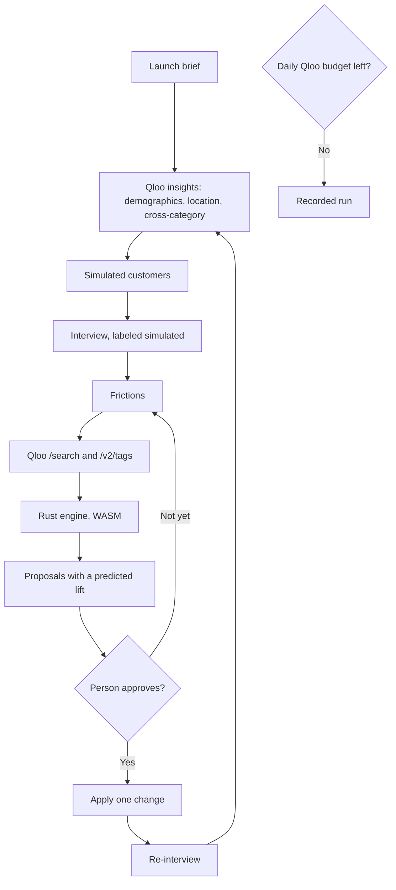

# TasteDraft

**Agents, but with taste.** A persona-first launch tester for the Qloo Agentic Hackathon 2026.

An indie artist can ask, before the on-sale, whether a Tokyo show and a merch drop would find a room. TasteDraft builds simulated customers from Qloo taste data, interviews them, and re-scores the brief in a deterministic engine. The number is a cultural resonance score. It is not a sales forecast. Every persona reply is labeled **Simulated persona response**.

| | |
|---|---|
| Live demo | `https://YOUR_DEMO_URL` |
| Video | `https://YOUR_VIDEO_URL` |
| License | [MIT](LICENSE) |

## Thirty seconds, no keys

The built-in sample needs no Qloo key and no language-model key.

1. Open the app. The opening brief is an indie artist launching a Tokyo tour and a merch drop, ages 18–25. The engine preview is **52**.
2. The calibrated sample, used when the API body is empty, is still Japanese minimalist streetwear in Los Angeles. That ledger scores **71** (anchor 24, cross 20, local 15, audience 17, friction −5). Evidence strength is HIGH for that authored audience.
3. Approve that sample's top proposal, price level 3 → 2. The same engine re-scores to **80**. The model does not write the number.

That 71 → 80 path is the calibrated sample. Live Qloo affinities use a different scorer and can leave a row empty. See [Case studies](#case-studies).

## How a launch moves



The same WASM build scores in the browser preview and on the server. `ENGINE=ts` selects the TypeScript scorer. Parity tests keep the two aligned.

## Where Qloo is used

Hackathon calls go to `https://hackathon.api.qloo.com` with the `X-Api-Key` header. The client sends GET requests only. An empty `QLOO_API_KEY` stays on an authored sample. Those bodies are not cached Qloo responses.

| Surface | Call | What it asks |
|---|---|---|
| Resolve a name | `GET /search` | Artist, brand, place, or other entity. Types are URN strings such as `urn:entity:artist`. |
| Fuzzy interest | `GET /v2/tags` | Tag lookup, including semantic search when the name is fuzzy. |
| Demographic fit | `GET /v2/insights` | `filter.type=urn:demographics` with the entity and a location. Age and gender skews run from −1 to 1. Age or gender alone, with no location, is HTTP 400. |
| Competitors | `GET /v2/insights` | Affinity for the competitor entities, with explainability. A miss retries without the persona's anchors. |
| Neighborhood | `GET /v2/insights` | `urn:heatmap` plus `urn:entity:place` for the city. The heatmap call does not send `output.heatmap.boundary` (that parameter returns HTTP 500). Empty heat falls back to place pins. |
| Niche finder | `GET /search`, then `GET /v2/insights` | Entities under a popularity cap. `bias.trends` is sent, then dropped if that type rejects it. |
| Activation | `GET /v2/insights` | Places, podcasts, and partner brands for the brief. |
| Re-interview | `GET /v2/insights` | The same personas against the references after a person approves a change. |
| Persona chat | No new Qloo call | The reply may cite only anchors already on that persona. |
| Business impact | No Qloo call | An avoided-cost estimate from the caller's own assumptions, with a disclaimer. It is not a revenue forecast. |
| Map | `GET /v2/insights` | The neighborhood heatmap. A price-friction layer can add `heatmap.dimensions=price_level`. |

`videogame` is the entity type. `video_game` is not.

If a live call does not land, the agent runner plays a derived recording and labels the result **Recorded run**. Recordings keep ids, names, and heatmap `lat`, `lng`, `weight`, and `label`. They omit response bodies, affinity, image URLs, and request URLs. The daily cap does this on purpose: after `QLOO_DAILY_BUDGET` live calls (default 400 per UTC day), the client refuses before the network. Cache hits do not spend the budget.

## Persona chat

`POST /api/features/persona-chat`.

The default provider is OpenRouter (`LLM_PROVIDER=openrouter`, base `https://openrouter.ai/api/v1`, OpenAI-compatible). The default model is `google/gemini-2.5-flash-lite`, with `meta-llama/llama-3.2-3b-instruct` as a cheaper fallback sent in the `models` array. Gemini 2.0 Flash no longer has OpenRouter endpoints, so it is not the default.

The call allows 120 output tokens and 8 seconds. The reply must start with **Simulated persona response** and must cite an anchor that belongs to that persona. A missing key, a timeout, an ungrounded reply, or an invented entity falls back to a template that names the persona's strongest anchors. The fallback is labeled the same way.

`LLM_PROVIDER` may also be `xai`, `openai`, or `anthropic`.

## Case studies

Four real Tokyo entries, scored only from pre-launch facts, then compared with the public outcome. The rule was locked first: encourage only when the total is at least 55 and local fit is at least 50.

| Launch | What happened | Verdict | Match |
|---|---|---|---|
| Billie Eilish, first solo Japan show, 2022 | Sold out | Caution (45) | Miss |
| Olivia Rodrigo, first Japan concert, 2024 | Sold out | Encourage (55) | Match |
| Harry Styles, first solo Japan shows, 2017 | Sold out | Caution (44) | Miss |
| Forever 21, first Japan store, 2009 | Left in 2019 | Caution (42) | Match |

Local place fit is high for all four (85–89) and does not separate a sellout from an exit. The anchor row was a gap on every call, because insights did not return an affinity for the subject entity itself. Two matches out of four is the result. The full table, the contamination note, and the sources are in [docs/case-studies.md](docs/case-studies.md). The derived fixture the UI can read is [apps/web/public/case-studies.json](apps/web/public/case-studies.json).

## Honest limits

- The score is not a forecast of tickets, stores, or revenue.
- Personas are simulated. The label is part of the reply, including the template fallback.
- Qloo's graph is current. A 2009 or 2017 brief is still scored on today's affinities.
- The sample 71 → 80 path does not run on live affinities. Live rows with no affinity stay empty, and evidence stays LIMITED when a dimension is missing or the brief has a single reference.
- The Tokyo case studies matched 2 of 4 public outcomes under a rule chosen in advance.
- The opening screen is the Tokyo tour. The empty-body API sample remains the Los Angeles streetwear brief at 71, then 80.
- A full daily budget or a failed live call becomes a Recorded run, not a silent sample score.
- Impact math uses numbers the caller supplies. It does not ask Qloo what the launch will earn.

## Repository

```
apps/web              Next.js, TypeScript, Tailwind CSS
apps/api              Hono on Node. Qloo client, agent, SQLite
packages/contracts    Zod schemas shared by the API and the web client
packages/engine-rs    Deterministic Rust scorer
packages/engine-wasm  One WASM build for Node, one for the browser, plus parity tests
ops                   Caddyfile and the SQLite backup script
```

`packages/engine-wasm/pkg` is committed, so a checkout can score without a Rust toolchain. Rebuild with `packages/engine-rs/scripts/build-wasm.sh`.

## Run locally

Node.js 22.13 or newer.

```bash
npm install
cp .env.example .env.local
npm run dev
```

The web app is [http://127.0.0.1:3000](http://127.0.0.1:3000). The API is [http://127.0.0.1:8787](http://127.0.0.1:8787) and binds `0.0.0.0`. Leave the keys empty to stay on the sample audience.

| Variable | Role |
|---|---|
| `QLOO_API_KEY` | Live search, tags, insights, and heatmap. Empty stays on the sample. |
| `LLM_PROVIDER` | `openrouter` (default), `xai`, `openai`, or `anthropic`. |
| `LLM_API_KEY` | Persona chat and the score-free interpreter. Empty uses templates. |
| `LLM_BASE_URL` | Default `https://openrouter.ai/api/v1`. |
| `LLM_MODEL` | Default `google/gemini-2.5-flash-lite`. |
| `LLM_FALLBACK_MODEL` | Default `meta-llama/llama-3.2-3b-instruct`. Empty disables the fallback. |
| `ENGINE` | `wasm` (default) or `ts`. |
| `EVIDENCE_PROVIDER` | `sample`, `fallback`, or `qloo`. Unset follows the Qloo key. |
| `HOST` / `PORT` | Default `0.0.0.0:8787`. |
| `DATABASE_PATH` | Default `data/tastedraft.sqlite`. |
| `QLOO_DAILY_BUDGET` | Default 400 live calls per UTC day, then Recorded run. |
| `RATE_LIMIT_PER_MINUTE` | Default 60 per address. `GET /api/health` is exempt. |
| `CORS_ORIGINS` | Comma-separated browser origins. No wildcard. |
| `NEXT_PUBLIC_API_URL` | API origin baked into the web build. Wins over `NEXT_PUBLIC_API_BASE_URL`. |

`GET /api/health` reports the engine, whether Qloo and the language model are configured, and the budget. It does not report key values.

| Command | What it does |
|---|---|
| `npm run dev` | API and Next.js together. |
| `npm run build` | Production build of `apps/web`, then a typecheck of `apps/api`. |
| `npm test` | API tests, Rust/WASM parity, and the web label tests. |
| `npm run backtest -w @tastedraft/api` | Five sourced city entries. Needs a Qloo key. Derived lines only. |
| `npm run case-studies -w @tastedraft/api` | The four Tokyo launches. Needs a Qloo key. Writes the derived fixture. |

Live response bodies are cached under `apps/api/data/qloo-cache/`. The cache key hashes the API key. The key is not written into the file. `.env.local`, the cache, and `*.sqlite` are gitignored.

## Deploy

The API image and the Cloudflare Pages build are prepared in [docs/deploy.md](docs/deploy.md). This repo does not deploy them. Put keys only on the API host. Set `NEXT_PUBLIC_API_URL` on Pages at build time, and set `CORS_ORIGINS` on the API to that Pages origin.

A Devpost draft is in [docs/devpost.md](docs/devpost.md). Screenshot captions are in [docs/screenshot-plan.md](docs/screenshot-plan.md). Image credits for the sample covers are in [docs/IMAGE_SOURCES.md](docs/IMAGE_SOURCES.md).
