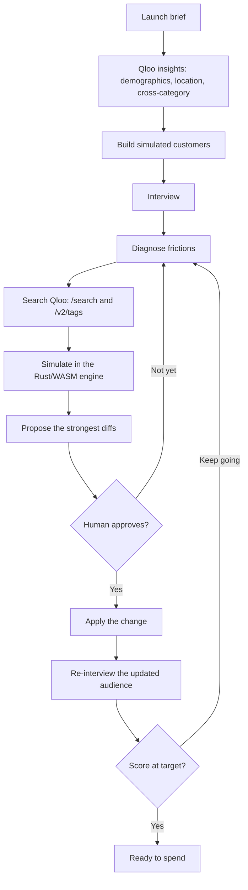

# TasteDraft

**Agents, but with taste.** A Qloo Agentic Hackathon project.

**Not another AI focus group. Every change is traceable to cultural evidence.**

**Test your launch with simulated customers before you spend.** The number on the result is a cultural resonance score, not a sales forecast. Personas stay labeled simulated. Evidence confidence is HIGH, MEDIUM, or LIMITED.

TasteDraft is for a small brand or a creator about to enter a city they do not know yet: a pop-up, a drop, a menu, a show. You describe the launch. The agent builds customers from Qloo taste data, interviews them, and shows which change would move the room before any money goes out.

| | |
|---|---|
| Live demo | `https://YOUR_DEMO_URL` |
| Video | `https://YOUR_VIDEO_URL` |

## The agent loop

Each round is the same conversation, with a tighter brief.

1. **Personas.** `/v2/insights` turns the brief into customers: age and gender, the city, and the other categories those people already love.
2. **Interview.** The agent asks that audience how the launch lands, in plain language.
3. **Diagnose.** Measured frictions come back as concrete problems: price, positioning, age band, place, channel, or a reference that does not belong.
4. **Search.** `/search` and `/v2/tags` look for a fix: another reference, a tag, a district, a price band.
5. **Simulate.** A deterministic Rust engine, compiled to WebAssembly, re-scores every candidate. The same build runs in the browser preview and on the server. TypeScript parity tests lock the two together. The model does not invent the number.
6. **Propose.** The strongest changes are shown as Qloo parameter diffs, each with the engine’s predicted lift.
7. **Approve.** A person picks one. Nothing in the brief changes until then.
8. **Re-interview.** The updated brief goes back to the same customers. The loop repeats until the score reaches the target you are willing to spend against.



With no API keys, a built-in sample audience still runs the loop. The default brief scores **71**. Approving the top proposal (price level 3 → 2) re-scores to **80**.

## Qloo

Hackathon calls go to `https://hackathon.api.qloo.com` with the `X-Api-Key` header. The client sends GET requests only.

| Call | What TasteDraft asks for |
|---|---|
| `GET /search` | Brands, artists, places, and other entities behind the brief and behind a proposed fix |
| `GET /v2/tags` | Interest tags, including a semantic lookup when the name is fuzzy |
| `GET /v2/insights` | Affinity for the launch. Signals include `signal.demographics` (age, gender), `signal.location`, and cross-category `signal.interests` (entities and tags). Explainability stays on the call |
| `GET /v2/insights` with `filter.type=urn:heatmap` | District heatmap cells for the launch city. The call does not send `output.heatmap.boundary` (that parameter returns HTTP 500 on the hackathon host). A price-friction layer adds `heatmap.dimensions=price_level`. If the heatmap is empty, the map falls back to place pins |

An empty `QLOO_API_KEY` stays on local mock bodies. Those mocks are authored for TasteDraft. They are not cached Qloo responses.

If a live Qloo call fails, the runner plays back a derived recording and labels the result **Recorded run**. A recording keeps entity ids and names, tag ids and names, and heatmap `id`, `lat`, `lng`, `weight`, and `label`. It omits response bodies, affinity, image URLs, and request URLs. Runtime files go in `apps/api/data/recordings/`, which is gitignored. `apps/api/src/runner/recordings/derived.json` is the same minimal shape, using sample names already in this repo, not a raw Qloo payload.

An LLM-only pass of the same brief calls no Qloo endpoint, stays generic, and stops at `insufficient_evidence`. The result screen can put that pass beside the Qloo-grounded run.

`npm run backtest -w @tastedraft/api` asks live Qloo about five sourced city entries, using the real city string. It does not fall back to the sample graph. Read `docs/backtest.md` for what those calls did and did not line up with.

## Architecture

```
apps/web              Next.js, TypeScript, Tailwind CSS
apps/api              Hono on Node. Qloo client, agent, SQLite
packages/contracts    Zod schemas shared by the API and the web client
packages/engine-rs    Deterministic Rust scorer
packages/engine-wasm  One WASM build for Node, one for the browser, plus TS parity tests
```

`packages/engine-wasm/pkg/nodejs` is what the API loads. `packages/engine-wasm/pkg/web` is what the browser loads for a live preview of a proposal. Both builds are committed, so a checkout can score without a Rust toolchain. Rebuild them with `packages/engine-rs/scripts/build-wasm.sh`.

`ENGINE=wasm` is the default. `ENGINE=ts` selects the TypeScript scorer, which the parity tests keep aligned with the Rust engine.

`split/` is the earlier single-file screen. The API still rebuilds it (`node split/build.mjs` → `dist/TasteDraft.dc.html`) and can serve that file beside the Next.js app. The original bundles, from before that split, are in [`docs/archive/reference/`](docs/archive/reference/).

## Setup

Node.js 22.13 or newer.

```bash
npm install
cp .env.example .env
npm run dev
```

The web app is [http://127.0.0.1:3000](http://127.0.0.1:3000). The API is [http://127.0.0.1:8787](http://127.0.0.1:8787) and binds `0.0.0.0` so a host can reach it.

| Variable | Role |
|---|---|
| `QLOO_API_KEY` | Live search, tags, insights, and heatmap. Empty stays on the sample audience |
| `LLM_API_KEY` | Optional. OpenAI-compatible key for the interviewer. Empty keeps interview, explanation, and critique deterministic |
| `LLM_BASE_URL` | Chat completions base URL. Default `https://api.openai.com/v1` |
| `LLM_MODEL` | Model name. Default `gpt-4o-mini` |
| `ENGINE` | `wasm` (default) or `ts` |
| `EVIDENCE_PROVIDER` | `sample`, `fallback` (Wikidata, MusicBrainz, OpenStreetMap), or `qloo`. Unset follows the Qloo key |
| `HOST` / `PORT` | API bind. Default `0.0.0.0:8787` |
| `DATABASE_PATH` | Local SQLite file. Default `data/tastedraft.sqlite` |
| `NEXT_PUBLIC_API_BASE_URL` | Origin the browser calls. Default `http://127.0.0.1:8787` |

Ledger numbers stay on the server. The optional model writes sentences, and the engine writes the score.

## Run and test

| Command | What it does |
|---|---|
| `npm run dev` | API and Next.js together |
| `npm run build` | Production build of `apps/web`, then a typecheck of `apps/api` |
| `npm test` | API tests, Rust/WASM parity, and the web label tests |
| `npm test -w @tastedraft/engine-wasm` | Parity only: the WASM build against the TypeScript scorer |
| `npm run screenshots` | Playwright shots at 390×844 and 1440×900 |

## Data policy

Live Qloo response bodies are cached on disk under `apps/api/data/qloo-cache/` (and `.qloo-cache/` if a tool writes there). The cache key hashes the API key. The key itself is not written into the file. Those directories, root `.env`, and the local SQLite file are gitignored. Cached responses are never committed.

## License

[MIT](LICENSE). Copyright (c) 2026 TasteDraft contributors.

Image credits for the sample covers live in [docs/IMAGE_SOURCES.md](docs/IMAGE_SOURCES.md). A Devpost draft is in [docs/submission.md](docs/submission.md).
