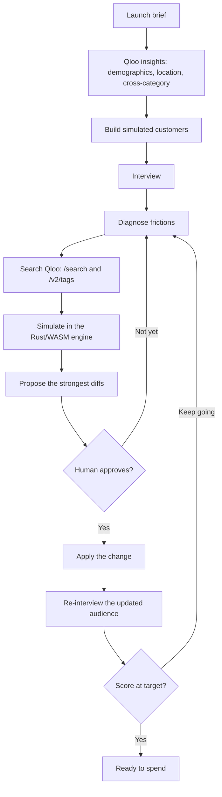

# TasteDraft — Devpost draft

Hackathon: **Qloo Agentic Hackathon — Agents, but with taste**

Paste the sections below into Devpost. Replace the two URL placeholders before submitting.

## Project name

TasteDraft

## Tagline

Test your launch with simulated customers before you spend.

## About

A small brand or a creator is about to enter a new city: a pop-up, a drop, a menu, a show. Rent, inventory, and ads are the expensive way to learn that the audience wanted a different price, a different block, or a different reference. TasteDraft runs that lesson first.

You write the launch. TasteDraft builds customers from Qloo taste data, interviews them, and will not change the plan until a person approves. Every score comes from a deterministic engine, so the agent can explain a lift and cannot invent one.

### What it does

- Turns a brief into simulated customers using Qloo demographics, location, and cross-category taste.
- Interviews those customers and diagnoses what is in the way: price, positioning, age, place, channel, or a reference that does not fit.
- Searches Qloo for a fix, then simulates each candidate in a Rust engine compiled to WebAssembly.
- Shows the strongest proposals as concrete parameter changes, with the predicted score delta.
- Waits for a person to approve. Then it re-interviews the same city on the updated brief and repeats until the score reaches the target.

### The loop

### How we built it

- **Web:** Next.js and Tailwind CSS. The browser loads the same WebAssembly scorer as the server, so a proposal’s delta is visible before Apply.
- **API:** Hono and TypeScript. It talks to the Qloo hackathon host (`https://hackathon.api.qloo.com`, header `X-Api-Key`) and stores projects in local SQLite.
- **Qloo:** `GET /search`, `GET /v2/tags`, and `GET /v2/insights`. Insight calls carry `signal.demographics`, `signal.location`, and cross-category `signal.interests`. The district map uses `filter.type=urn:heatmap` (`output.heatmap.boundary=urn:entity:locality`), with place pins when a heatmap cell list comes back empty.
- **Engine:** Rust, compiled once for Node and once for the browser. A TypeScript parity suite checks that both paths score the same brief the same way. `ENGINE=ts` keeps the TypeScript scorer available.
- **Language model (optional):** an OpenAI-compatible chat model (`LLM_API_KEY`, `LLM_BASE_URL`, `LLM_MODEL`) writes the interview. It does not receive ledger numbers and does not choose the score. With no model key, the interview stays deterministic.

Without a Qloo key the sample audience still completes a round: the default brief scores 71, and the approved price change re-scores to 80.

### Challenges

Hackathon keys work on `hackathon.api.qloo.com` only. Qloo’s demographic buckets are wider than the age bands a brand actually uses, so an audience signal stays marked limited when the ranges do not line up, instead of being treated as a precise match. Heatmap coverage is uneven by city, so the map has to say when it is showing place pins rather than heat. The agent is only useful if a person can see the number move before they spend, which is why the scorer is shared, deterministic, and covered by parity tests.

### Accomplishments

- A full loop from Qloo insight to a human-approved change and a second interview.
- One scoring engine for the server and the browser, with parity tests against the TypeScript implementation.
- A path that runs with no keys, and a live path that uses search, tags, insights, and heatmap when `QLOO_API_KEY` is set.
- Local caching of Qloo responses so the demo can be repeated without committing those bodies.

### What’s next

Publish the live demo and the walkthrough video at the URLs below. Host the API somewhere the SQLite file is replaced by durable storage, and keep the Qloo cache on disk local to that host.

## Built with

Qloo Hackathon API, Next.js, Tailwind CSS, Hono, TypeScript, Zod, Rust, WebAssembly, SQLite, optional OpenAI-compatible LLM.

## Links

- Live demo: `https://YOUR_DEMO_URL`
- Video: `https://YOUR_VIDEO_URL`
- Source: this repository (private)

## Data and license

Qloo responses are cached locally and are never committed. The API key is not written into the cache. The project is MIT licensed.
